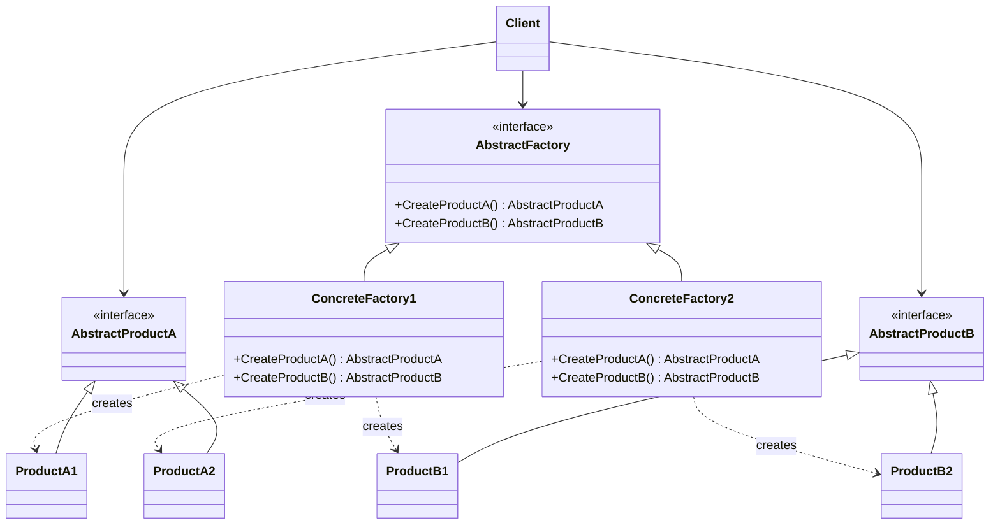

Abstract Factory Pattern
========================

We define the instances produced by factory class as __products__.

Applicability
-------------

Use the Abstract Factory Pattern when

- a system should be independent of how its products are created, composed, and represented
- a system should be configured with one of multiple families of products
- a family of related product objects is designed to be used together, and we need to enforce this constraint
- we want to provide a class library of products, and we want to reveal just their interface, not their implementations

Structure
---------



Participants
------------

- `AbstractFactory`: declares an __interface__ for operations that _create_ abstract product objects.
- `ConcreteFactory`: implements the operations to create concrete product objects.
- `AbstractProduct`: declares an __interface__ for a type of product object.
- `ConcreteProduct`: implements the `AbstractProduct` interface and defines a product object to be created by the
  corresponding concrete factory.
- `Client`: uses only interfaces declared by `AbstractFactory` and `AbstractProduct` classes.

Collaborations
--------------

- Normally a single instance of a `ConcreteFactory` class is created at run-time. This concrete factory creates product
  objects of a particular implementation. To create objects of different implementation, clients should use a different
  concrete factory.
- `AbstractFactory` defers creation of product objects to its ConcreteFactory subclass.

Implementation
--------------

Here are some useful techniques for implementing the Abstract Factory pattern.

- _Factories as Singletons_. An application typically needs only one instance of a `ConcreteFactory` per product. So
  it's best implemented as a Singleton

Example Code
------------

The context of this example code is within a development of a Java-based webservice offering REST API endpoints for
reading and writing against a graph database.

In this example, the factory produces a family of related collaborator components:

- the database connection lifecycle (`GraphDatabase`) and, 
- its vendor-specific query language generator (`QueryDialect`).

### Abstract Products (The Component Contracts)

```java
package com.myorg.webservice.graph;

public interface GraphDatabase extends AutoCloseable {
    
    void connect();
    
    void execute(String query);
    
    @Override
    void close();
}
```

```java
package com.myorg.webservice.graph;

public interface QueryDialect {
    
    String buildTraversal(String startNodeId, int depth);
}
```

### Abstract Factory Contract

The abstract factory defines the operations that create the family of related products. It binds the database instance
and dialect together, guaranteeing that client code never pairs an ArangoDB connection with a Cypher query.

```java
package com.myorg.webservice.graph;

public interface GraphDatabaseFactory {
    
    GraphDatabase createDatabase();
    
    QueryDialect createDialect();
}
```

### Concrete Family

#### ArangoDB

This package encapsulates the ArangoDB family. The factory accepts the vendor-specific configuration records and
manufactures mutually compatible products.

```java
package com.myorg.webservice.graph.arango;

import com.myorg.webservice.graph.GraphDatabase;

public class ArangoDatabase implements GraphDatabase {
    
    private final String url;
    private final String dbName;

    public ArangoDatabase(String url, String dbName) {
        this.url = url;
        this.dbName = dbName;
    }

    @Override
    public void connect() {
        System.out.println("Connected to ArangoDB at " + this.url + "/" + this.dbName);
    }

    @Override
    public void execute(String aqlQuery) {
        System.out.println("Executing AQL query: " + aqlQuery);
    }

    @Override
    public void close() {
        System.out.println("ArangoDB connection pool closed.");
    }
}
```

```java
package com.myorg.webservice.graph.arango;

import com.myorg.webservice.graph.QueryDialect;

public class ArangoDialect implements QueryDialect {
    
    @Override
    public String buildTraversal(String startNodeId, int depth) {
        return "FOR v IN 1.." + depth + " OUTBOUND 'my_vertices/" + startNodeId + "' GRAPH 'my_graph' RETURN v";
    }
}
```

```java
package com.myorg.webservice.graph.arango;

import com.myorg.webservice.graph.GraphDatabase;
import com.myorg.webservice.graph.GraphDatabaseFactory;
import com.myorg.webservice.graph.QueryDialect;

public class ArangoDatabaseFactory implements GraphDatabaseFactory {
    
    private final String url;
    private final String dbName;

    public ArangoDatabaseFactory(String url, String dbName) {
        this.url = url;
        this.dbName = dbName;
    }

    @Override
    public GraphDatabase createDatabase() {
        return new ArangoDatabase(this.url, this.dbName);
    }

    @Override
    public QueryDialect createDialect() {
        return new ArangoDialect();
    }
}
```

Note that in dependency-injected architectures, singleton lifecycle is typically enforced by the container's application
scope which is why we didn't explicitly implement `ArangoDatabaseFactory` as singleton

#### Neo4j

This package supplies the Neo4j family. It implements the exact same factory interface, isolating Bolt credentials and
Cypher generation from the rest of the application.

```java
package com.myorg.webservice.graph.neo4j;

import com.myorg.webservice.graph.GraphDatabase;

public class Neo4jDatabase implements GraphDatabase {
    
    private final String boltUri;
    private final String user;

    public Neo4jDatabase(String boltUri, String user) {
        this.boltUri = boltUri;
        this.user = user;
    }

    @Override
    public void connect() {
        System.out.println("Connected to Neo4j via Bolt at " + this.boltUri + " as " + this.user);
    }

    @Override
    public void execute(String cypherQuery) {
        System.out.println("Executing Cypher query: " + cypherQuery);
    }

    @Override
    public void close() {
        System.out.println("Neo4j driver connection closed.");
    }
}
```

```java
package com.myorg.webservice.graph.neo4j;

import com.myorg.webservice.graph.QueryDialect;

public class Neo4jDialect implements QueryDialect {
    
    @Override
    public String buildTraversal(String startNodeId, int depth) {
        return "MATCH (a:MyVertex {id: '" + startNodeId + "'})-[:MyEDGE*1.." + depth + "]->(b) RETURN b";
    }
}
```

```java
package com.myorg.webservice.graph.neo4j;

import com.myorg.webservice.graph.GraphDatabase;
import com.myorg.webservice.graph.GraphDatabaseFactory;
import com.myorg.webservice.graph.QueryDialect;

public class Neo4jDatabaseFactory implements GraphDatabaseFactory {
    
    private final String boltUri;
    private final String user;

    public Neo4jDatabaseFactory(String boltUri, String user) {
        this.boltUri = boltUri;
        this.user = user;
    }

    @Override
    public GraphDatabase createDatabase() {
        return new Neo4jDatabase(this.boltUri, this.user);
    }

    @Override
    public QueryDialect createDialect() {
        return new Neo4jDialect();
    }
}
```

### Client Consumption

The client depends strictly on `GraphDatabaseFactory`, `GraphDatabase`, and `QueryDialect`. It remains completely
unaware of whether ArangoDB or Neo4j is running underneath.

```java
package com.myorg.webservice.client;

import com.myorg.webservice.graph.GraphDatabase;
import com.myorg.webservice.graph.GraphDatabaseFactory;
import com.myorg.webservice.graph.QueryDialect;

public class GraphAnalyticsService {

    private final GraphDatabase database;
    private final QueryDialect dialect;

    public GraphAnalyticsService(GraphDatabaseFactory factory) {
        this.database = factory.createDatabase();
        this.dialect = factory.createDialect();
        this.database.connect();
    }

    public void runTraversal(String rootVertexId, int depth) {
        String query = this.dialect.buildTraversal(rootVertexId, depth);
        this.database.execute(query);
    }

    public void shutdown() {
        this.database.close();
    }
}
```
